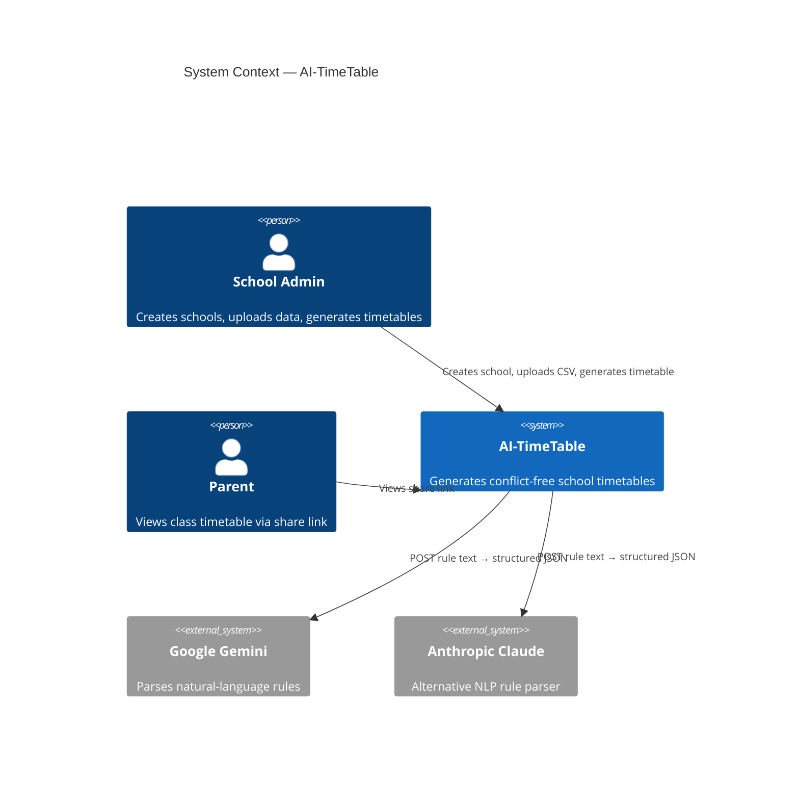
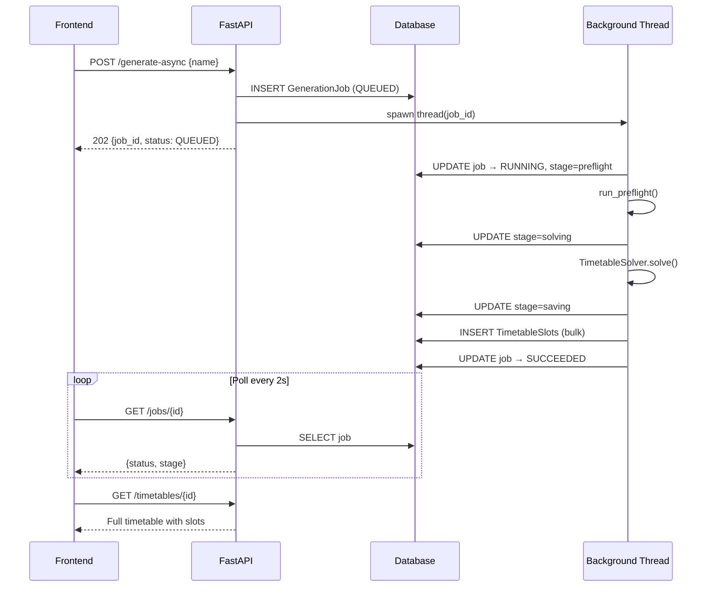
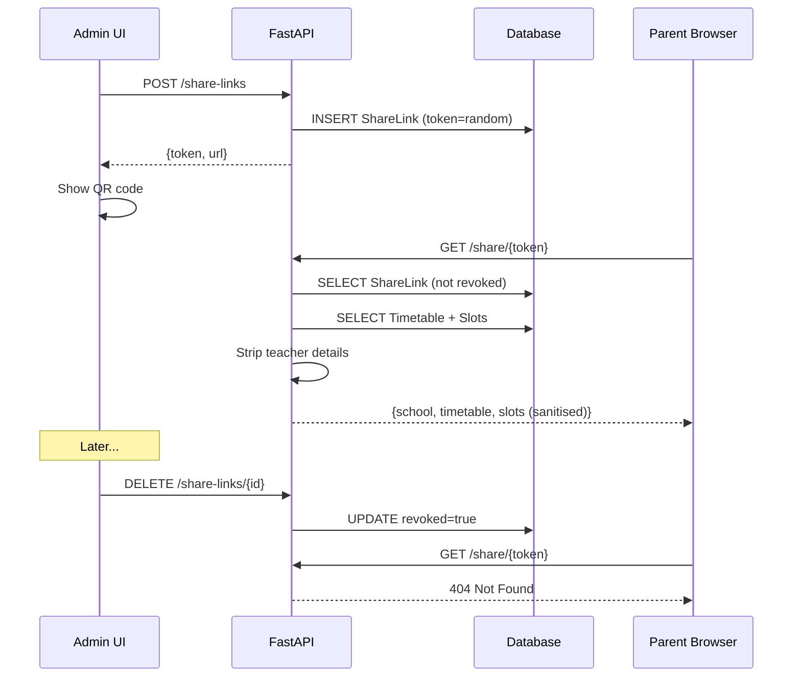

# 🏛️ Architecture (Detailed)

> Back to [[00 - Project Overview]] · See also [[01 - Architecture]] for the summary version

This note goes deeper than [[01 - Architecture]], covering internal component design, data flow sequences, and architectural decisions with their rationale.

---

## System Context



---

## Component Architecture

### Backend Components

```
┌─────────────────────────────────────────────────────────┐
│  FastAPI Application                                     │
│                                                         │
│  ┌─────────────┐  ┌──────────────┐  ┌───────────────┐  │
│  │  API Layer   │  │  Dependency  │  │   Schemas     │  │
│  │  (Routes)    │──│  Injection   │  │   (Pydantic)  │  │
│  │             │  │  (deps.py)   │  │               │  │
│  │  auth       │  └──────┬───────┘  └───────────────┘  │
│  │  school     │         │                              │
│  │  academic   │         ▼                              │
│  │  teacher    │  ┌──────────────┐                      │
│  │  timetable  │  │   Service    │                      │
│  │  fixed_slot │──│   Layer      │                      │
│  │  rule       │  │             │                      │
│  │  share      │  │  csv_import │                      │
│  └─────────────┘  │  preflight  │                      │
│                   │  generation │                      │
│                   │  solver     │                      │
│                   │  excel_exp  │                      │
│                   │  ai_rules   │                      │
│                   └──────┬──────┘                      │
│                          │                              │
│                   ┌──────▼──────┐                      │
│                   │   Core      │                      │
│                   │  config     │                      │
│                   │  database   │                      │
│                   │  security   │                      │
│                   │  migrate    │                      │
│                   └──────┬──────┘                      │
│                          │                              │
│                   ┌──────▼──────┐                      │
│                   │   Models    │                      │
│                   │  (ORM)      │                      │
│                   └──────┬──────┘                      │
│                          │                              │
└──────────────────────────┼──────────────────────────────┘
                           │
                    ┌──────▼──────┐
                    │  Database   │
                    │ SQLite / PG │
                    └─────────────┘
```

### Frontend Components

```
┌───────────────────────────────────────────┐
│  Next.js 14 App                           │
│                                           │
│  ┌──────────────────────┐                 │
│  │  Layout (layout.tsx)  │                 │
│  │  Header + Nav + Theme │                 │
│  └──────────┬───────────┘                 │
│             │                             │
│  ┌──────────▼───────────┐                 │
│  │  Pages               │                 │
│  │  ┌─────┐ ┌────────┐  │                 │
│  │  │  /  │ │ /login  │  │                 │
│  │  └─────┘ └────────┘  │                 │
│  │  ┌───────┐ ┌───────┐ │                 │
│  │  │/setup │ │/rules │ │                 │
│  │  └───────┘ └───────┘ │                 │
│  │  ┌──────────────────┐│                 │
│  │  │ /school/[id]     ││                 │
│  │  │  └─ /timetable/  ││                 │
│  │  └──────────────────┘│                 │
│  │  ┌──────────────────┐│                 │
│  │  │ /share/[token]   ││                 │
│  │  └──────────────────┘│                 │
│  └──────────┬───────────┘                 │
│             │                             │
│  ┌──────────▼───────────┐                 │
│  │  Components          │                 │
│  │  UI primitives       │                 │
│  │  ThemeToggle         │                 │
│  │  UserMenu            │                 │
│  │  ShareLinks + QR     │                 │
│  └──────────┬───────────┘                 │
│             │                             │
│  ┌──────────▼───────────┐                 │
│  │  Lib                 │                 │
│  │  api.ts (fetcher)    │                 │
│  │  types.ts            │                 │
│  └──────────────────────┘                 │
└───────────────────────────────────────────┘
```

---

## Key Architectural Decisions

### ADR 1: Background Generation via Threading
> **Decision**: Use `threading.Thread(daemon=True)` for background generation instead of Celery/Redis.

| Factor | Reasoning |
|--------|-----------|
| **Why not Celery** | Adds Redis dependency, complex setup, overkill for single-school generation |
| **Why threads** | Simple, no infrastructure, fits free-tier constraints |
| **Caveat** | Only one generation per process; multiple Render workers would need proper task queue |
| **Job persistence** | `GenerationJob` row in DB survives if the thread crashes |

### ADR 2: Room Assignment Post-Solve
> **Decision**: Rooms are assigned greedily AFTER the CP-SAT solve, not as part of the model.

| Factor | Reasoning |
|--------|-----------|
| **Why not in CP-SAT** | Including room variables would multiply the search space dramatically |
| **Why greedy works** | Room conflicts are rare — schools usually have more rooms than concurrent sections |
| **Trade-off** | A cell may get no room if all matching rooms are taken (room_id stays null) |

### ADR 3: Stdlib-Only Auth
> **Decision**: Use Python `hashlib.scrypt` + `hmac` + `json` instead of passlib/PyJWT.

| Factor | Reasoning |
|--------|-----------|
| **passlib breakage** | passlib breaks on Python 3.13+ (deprecated bcrypt bindings) |
| **Fewer dependencies** | No `python-jose`, `passlib`, `PyJWT` — smaller deploy, less supply chain risk |
| **Trade-off** | Manual JWT implementation (compact, ~70 lines) but well-tested |

### ADR 4: Auto-Startup Migrations
> **Decision**: On every boot, diff model columns vs DB schema and `ALTER TABLE ADD COLUMN`.

| Factor | Reasoning |
|--------|-----------|
| **Why not Alembic only** | Free-tier deploys don't support migration commands easily |
| **Why additive only** | Only adds columns (nullable) — never drops or renames |
| **Trade-off** | Models must tolerate NULL in new columns |

### ADR 5: Direct Backend Calls in Production
> **Decision**: In production, the browser calls the backend directly (not through Next.js proxy).

| Factor | Reasoning |
|--------|-----------|
| **Why not always proxy** | Vercel serverless has 10s timeout — background job polling needs multiple requests |
| **Why direct** | Bypasses Vercel entirely; Render handles its own cold start |
| **Implementation** | `NEXT_PUBLIC_BACKEND_URL` env var; locally falls back to `/api` rewrite |

### ADR 6: Single-Row Rule Config
> **Decision**: `RuleConfig` is a single global row (id=1), not per-school.

| Factor | Reasoning |
|--------|-----------|
| **Simplicity** | One admin, one set of rules — matches v2.1 scope |
| **Future** | Per-school rules planned for v3.0 |
| **Trade-off** | Multi-admin setups share the same rules until v3 |

---

## Request Flow Sequences

### Generate Timetable (Async)



### Share Link Flow



---

## Scalability Considerations

| Dimension | Current (v2.1) | Future Improvement |
|-----------|----------------|-------------------|
| **Concurrency** | Single thread per generation | Task queue (Celery/Redis) |
| **Database** | SQLite local / PG production | Connection pooling, read replicas |
| **Solver** | 8 workers, 180s cap | Distributed solving for mega-schools |
| **File storage** | In-memory export | S3/GCS for large exports |
| **Auth** | Single token type | Refresh tokens, OAuth providers |
| **Multi-tenancy** | Owner-based isolation | Organisation-level tenancy |

---

## Related

- [[01 - Architecture]] — summary version
- [[Modules & Phases]] — module breakdown
- [[05 - Solver Engine]] — CP-SAT internals
- [[07 - Auth & Security]] — auth architecture
- [[09 - Deployment Guide]] — infrastructure
