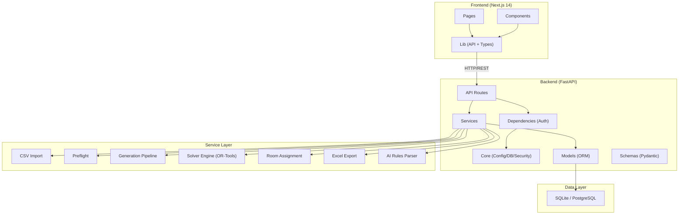
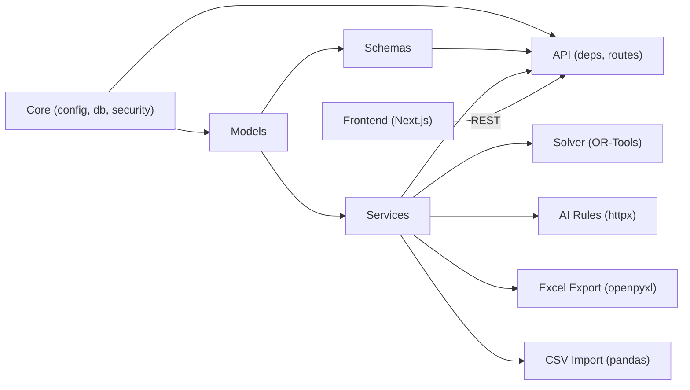

# 📦 Modules & Phases

> Back to [[00 - Project Overview]] · See also [[01 - Architecture]]

---

## Module Map

---

## Module Breakdown

### Module 1: Core Infrastructure
**Files**: `core/config.py`, `core/database.py`, `core/migrate.py`, `core/security.py`

| Component | Responsibility |
|-----------|---------------|
| `config.py` | Environment variables via Pydantic Settings |
| `database.py` | SQLAlchemy engine, session factory, `get_db()` |
| `migrate.py` | Startup column migrations (ALTER TABLE ADD COLUMN) |
| `security.py` | Password hashing (scrypt), JWT tokens (HS256) |

**Dependencies**: None (self-contained)

---

### Module 2: Data Models
**Files**: `models/user.py`, `models/school.py`, `models/academic.py`, `models/teacher.py`, `models/timetable.py`, `models/rule.py`

| Model | Count | Key Relations |
|-------|-------|---------------|
| `User` | 1 table | → School (owns) |
| `School` | 1 table | → WorkingDay, Period, Break, Subject, Standard, Room, Teacher, Timetable |
| `WorkingDay`, `Period`, `Break` | 3 tables | → School |
| `Subject`, `Standard`, `Section`, `Room` | 4 tables | → School, Standard→Section |
| `Teacher`, `TeacherAssignment` | 2 tables | → School, Subject, Section |
| `Timetable`, `TimetableSlot`, `FixedSlot`, `GenerationJob`, `ShareLink` | 5 tables | → School, Section, Teacher, Subject, Room |
| `RuleConfig`, `CustomRule` | 2 tables | Global (not school-scoped) |

**Total**: 18 tables

**Dependencies**: Module 1 (database, Base)

---

### Module 3: API Layer
**Files**: `api/deps.py`, `api/routes/auth.py`, `api/routes/school.py`, `api/routes/academic.py`, `api/routes/teacher.py`, `api/routes/timetable.py`, `api/routes/fixed_slot.py`, `api/routes/rule.py`, `api/routes/share.py`

| Route File | Endpoints | Auth Level |
|------------|-----------|------------|
| `auth.py` | 3 | Public |
| `share.py` | 1 | Public |
| `school.py` | 3 | Login + ownership |
| `academic.py` | 10 | School-scoped |
| `teacher.py` | 4 | School-scoped |
| `timetable.py` | 12 | School-scoped |
| `fixed_slot.py` | 3 | School-scoped |
| `rule.py` | 7 | Login only |

**Total**: ~43 endpoints

**Dependencies**: Module 1, Module 2, Module 4

---

### Module 4: Service Layer
**Files**: `services/csv_import.py`, `services/preflight.py`, `services/generation.py`, `services/solver/engine.py`, `services/excel_export.py`, `services/ai_rules.py`

| Service | Input | Output | Key Logic |
|---------|-------|--------|-----------|
| **CSV Import** | CSV/Excel bytes | DB rows | Parse → auto-create entities → TeacherAssignment |
| **Preflight** | School object | PreflightReport | Capacity math, lab checks, key period coverage |
| **Generation** | School + rules | Timetable | Pipeline: preflight → solve → rooms → save |
| **Solver** | Assignments + constraints | SolveResult | CP-SAT model: hard + soft constraints |
| **Excel Export** | Timetable slots | .xlsx bytes | openpyxl workbook with colour-coded grids |
| **AI Rules** | English text + API key | CustomRule dict | LLM call (Gemini/Claude) → structured parse |

**Dependencies**: Module 1, Module 2, OR-Tools, pandas, openpyxl, httpx

---

### Module 5: Frontend
**Files**: `src/app/` (pages), `src/components/` (UI), `src/lib/` (API + types)

| Page | Route | Purpose |
|------|-------|---------|
| Dashboard | `/` | List all schools, create new |
| Login | `/login` | Register/login form |
| Setup | `/setup` | New School wizard (multi-step) |
| School Detail | `/school/[id]` | CSV upload, teachers, timetable, export, share |
| Timetable View | `/school/[id]/timetable/[tid]` | Full timetable grid |
| Rules | `/rules` | Toggle built-in rules, custom rules, AI key |
| Share | `/share/[token]` | Public parent view |

| Component | Purpose |
|-----------|---------|
| `Card`, `Button`, `Input`, `Label`, `Badge` | UI primitives |
| `ThemeToggle` | Dark/light mode |
| `UserMenu` | Auth status + logout |
| `ShareLinks` | Share link CRUD + QR |

**Dependencies**: Next.js 14, React 18, SWR, Tailwind, qrcode

---

## Implementation Phases

### Phase 1: Foundation (v1.0)
> *"Make it work"*

- [x] SQLAlchemy models for school, teachers, subjects, sections
- [x] CSV import with auto-entity creation
- [x] CP-SAT solver with hard constraints (H1–H5)
- [x] Basic Next.js dashboard + school detail page
- [x] Timetable grid view (class view)
- [x] Soft constraints: spread, morning-heavy, back-to-back
- [x] SQLite default for zero-setup development

---

### Phase 2: Production Readiness (v2.0)
> *"Make it deployable"*

- [x] Background generation with job polling
- [x] Preflight feasibility check
- [x] Excel export (.xlsx with colour-coded sheets)
- [x] Teacher view in timetable
- [x] Fixed slots (assembly, library)
- [x] Room type enforcement (lab rooms)
- [x] Half-day support (Saturday fewer periods)
- [x] Render + Vercel deployment (render.yaml)
- [x] Auto-startup migrations (add missing columns)
- [x] Dark mode with no-flash

---

### Phase 3: Security & Sharing (v2.1 — Current)
> *"Make it secure and shareable"*

- [x] Email + password auth (scrypt + HS256 JWT)
- [x] School ownership model (multi-tenant)
- [x] Revocable parent share links with QR codes
- [x] Parent view strips staff details
- [x] Configurable scheduling rules UI
- [x] Custom rules via natural language (Gemini/Claude)
- [x] API key auto-detect (Gemini vs Claude)
- [x] Comprehensive test suites (27 smoke checks + solver test)
- [x] Editorial UI redesign (Instrument Serif, oklch, grain texture)

---

### Phase 4: Role Matrix (v3.0 — Planned)
> *"Make it collaborative"*

- [ ] Teacher accounts with read-only timetable access
- [ ] Approval chains (teacher → HOD → principal → publish)
- [ ] Per-school rule configuration (currently global)
- [ ] Email verification and password reset
- [ ] Notifications for timetable changes

---

### Phase 5: Advanced Scheduling (v3.1 — Planned)
> *"Make it smarter"*

- [ ] Multi-teacher subjects (team teaching)
- [ ] Substitute teacher suggestions
- [ ] Room-capacity-aware placement
- [ ] Historical load analytics
- [ ] Drag-and-drop timetable editing with re-validation

---

## Module Dependency Graph

---

## Related

- [[01 - Architecture]] — system diagram
- [[PRD]] — feature requirements
- [[04 - Database Schema]] — model details
- [[12 - Rules]] — rules module deep dive
