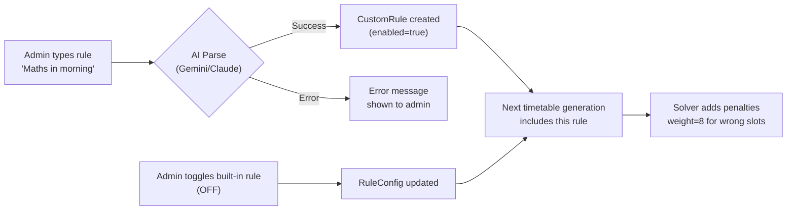

# ⚖️ Rules System

> Back to [[00 - Project Overview]] · See also [[05 - Solver Engine]]

The rules system has three layers: **hard constraints** (always enforced), **built-in soft rules** (toggleable), and **custom rules** (admin-defined, optionally AI-parsed).

---

## Layer 1: Hard Constraints (Non-Negotiable)

These are baked into the CP-SAT model and **cannot** be disabled. If they can't all be satisfied, the solver returns `INFEASIBLE`.

| ID | Rule | Implementation |
|----|------|----------------|
| **H1** | Each assignment gets exactly its required lectures per week | `sum(vars) == lectures` |
| **H2** | A class (section) has at most one lecture per slot | `sum(section_slot_vars) <= 1` |
| **H3** | A teacher is in at most one place per slot | `sum(teacher_slot_vars) <= 1` |
| **H4** | Teacher availability is respected | Variable not created for unavailable slots |
| **H5** | Fixed slots block the section's cell | Variable not created for fixed slots |
| **H6** | Lab room capacity per slot | `sum(lab_assignments) <= lab_room_count` |

> [!IMPORTANT]
> Hard constraints guarantee zero conflicts. The system **never** produces a timetable with a teacher double-booked or a class with two simultaneous subjects.

---

## Layer 2: Built-in Soft Rules (Toggleable)

Configurable via the **Rules page** (`/rules`). Stored in `RuleConfig` (single global row). Each rule adds weighted penalty terms to the solver's objective function.

### Toggle Controls

| Rule | Default | Weight | Effect |
|------|---------|--------|--------|
| `keep_key_periods_filled` | ✅ On | **15** (heavy) | 1st, 2nd, before/after break, and last period should be occupied |
| `teacher_rest_after_two` | ✅ On | **10** (strong) | Avoid 3 consecutive lectures for any teacher |
| `spread_subjects` | ✅ On | **1–6** (variable) | Prefer one occurrence per subject per day; penalise 3+ heavily |
| `avoid_back_to_back_free` | ✅ On | **2** (mild) | No two consecutive free periods for a class |
| `morning_hard_subjects` | ✅ On | **p** (period idx) | Subjects with `preferred_time="Morning"` penalised by period index |
| `max_doubles_per_week` | **2** | **4** | Cap on consecutive double periods per class per week |

### Numeric Controls

| Setting | Default | Range | Description |
|---------|---------|-------|-------------|
| `solve_time_limit` | 30 | 5–180 | Solver time budget in seconds |
| `max_doubles_per_week` | 2 | 0–10 | Max double periods per class per week |

---

## How Soft Rules Work

All soft rules contribute to a single objective:

```python
model.Minimize(sum(weight * violation_var for weight, violation_var in penalties))
```

Higher weights = stronger preference. The solver finds the solution with the minimum total penalty.

### Weight Hierarchy

```
15 — Key periods filled (strongest)
10 — Teacher rest after 2
 8 — Custom: subject time preference
 7 — Custom: subject max per day
 6 — Spread: never 3+ of same subject in a day
 6 — Custom: subject position avoidance
 4 — Doubles cap exceeded
 2 — Back-to-back free periods
 1 — Spread: prefer one per subject per day
 p — Morning preference (grows with period index)
```

---

## Protected Periods

"Key" periods that `keep_key_periods_filled` protects:

```
Day with 8 periods and lunch after period 4:

Period:  0    1    2    3    4    5    6    7
         1st  2nd  ...  pre  post ...  ... last
         ↑    ↑         ↑    ↑              ↑
       Protected     Protected          Protected
```

Protected = `{0, 1, lunch_after-1, lunch_after, last_period}`

If a protected period has no lecture (and no fixed slot), a penalty of **15** is added.

---

## Double Period Logic

The solver **allows** double periods (two consecutive of the same subject) but limits them:

1. For each subject in each section, on each day:
   ```
   dbl[p] = 1  iff  subject in period p AND period p+1
   ```
2. Sum all `dbl` indicators across the week for each section
3. If `sum(doubles) > max_doubles_per_week`: penalty of **4** × excess

This means:
- **max_doubles_per_week = 2** → up to 2 double periods per class per week (no penalty)
- **max_doubles_per_week = 0** → doubles are penalised but not impossible
- Subject spread (weight 1) also discourages same-day repeats, complementing this

---

## Layer 3: Custom Rules (Admin-Defined)

### Creating Custom Rules

Two methods:

#### Method A: Manual Creation
```
POST /api/rules/custom
{
    "rule_type": "subject_time",
    "subject_name": "Maths",
    "param_text": "morning",
    "enabled": true
}
```

#### Method B: Natural Language (AI-Parsed)
```
POST /api/rules/custom/parse
{ "text": "Keep Maths in the morning" }

→ AI returns:
{
    "rule_type": "subject_time",
    "subject_name": "Maths",
    "param_text": "morning",
    "param_int": null
}
→ Saved as CustomRule
```

### Rule Types

| Type | Description | Params | Weight |
|------|-------------|--------|--------|
| `subject_time` | Subject prefers morning or afternoon | `param_text`: "morning" / "afternoon" | **8** |
| `subject_max_per_day` | Max N periods of subject per class per day | `param_int`: max count | **7** |
| `subject_position` | Subject avoids first or last period | `param_text`: "first" / "last" | **6** |

### Subject Matching

Custom rules match subjects by **name** (case-insensitive):
```python
name_to_ids = {s.name.strip().lower(): s.id for s in school.subjects}
```
This means a rule for "Maths" applies to every school that has a subject named "Maths".

### Solver Translation

```python
# subject_time: penalise wrong time of day
if self._is_morning(p) != want_morning:
    penalties.append((8, x[(a.id, d, p)]))

# subject_max_per_day: soft cap
over = model.NewIntVar(0, N, "cmax_...")
model.Add(over >= sum(terms) - cap)
penalties.append((7, over))

# subject_position: avoid first/last
target = ndp - 1 if avoid_last else 0
penalties.append((6, x[(a.id, d, target)]))
```

---

## AI Rule Parsing

### System Prompt

The LLM receives a structured system prompt that constrains output to exactly one JSON object:

```
You convert a school-timetable rule written in plain English into a single JSON object.

Output ONLY a JSON object with:
  "rule_type": one of "subject_time", "subject_max_per_day", "subject_position"
  "subject_name": the subject
  "param_text": for time/position rules
  "param_int": for max-per-day rules

If the sentence cannot be expressed: {"error": "reason"}
```

### Supported Providers

| Provider | Model | Detection |
|----------|-------|-----------|
| **Gemini** (default) | `gemini-2.0-flash` | Key starts with anything (fallback) |
| **Claude** | `claude-haiku-4-5` | Key starts with `sk-ant-` |

### API Key Flow
```
Admin pastes API key → PUT /rules {ai_api_key: "..."}
    → detect_provider(): starts with "sk-ant-" ? "claude" : "gemini"
    → Store in RuleConfig (ai_api_key, ai_provider)
    → Frontend shows "AI key set ✓" (key never exposed, only has_ai_key bool)
```

### Example Translations

| English Input | Parsed Output |
|---------------|---------------|
| "Keep Maths in the morning" | `{type: subject_time, subject: Maths, text: morning}` |
| "PE at most once a day" | `{type: subject_max_per_day, subject: PE, int: 1}` |
| "Library should never be the last period" | `{type: subject_position, subject: Library, text: last}` |
| "Make the school prettier" | `{error: "Cannot express as a scheduling rule"}` |

---

## Rules API Summary

| Method | Path | Description |
|--------|------|-------------|
| `GET /api/rules` | Get current rule config (safe — no API key exposed) |
| `PUT /api/rules` | Update toggles, time limit, AI key |
| `GET /api/rules/custom` | List all custom rules |
| `POST /api/rules/custom` | Create rule manually |
| `POST /api/rules/custom/parse` | Create rule from English text |
| `PATCH /api/rules/custom/{id}` | Toggle enable/disable |
| `DELETE /api/rules/custom/{id}` | Delete rule |

---

## Rules Lifecycle



---

## Common Rule Combinations

| Scenario | Rules to Enable |
|----------|----------------|
| **Strict school** | All on, max_doubles=0, time_limit=60 |
| **Relaxed school** | Key periods off, doubles=4, time_limit=15 |
| **Exam prep** | Morning hard subjects on, spread on, rest off |
| **Minimum viable** | All off except H1–H6 (hard only) |

---

## Gotchas

> [!WARNING]
> - **Rules are global** — they apply to all schools (per-school planned for v3.0)
> - Custom rules match by **subject name** — a rule for "Maths" affects every school with a "Maths" subject
> - Disabling all soft rules means the solver only enforces hard constraints — valid but unoptimised
> - The AI key is stored in the database (plaintext) — acceptable for admin-only access but noted for future security review

---

## Related

- [[05 - Solver Engine]] — how penalties feed into the objective function
- [[06 - Services Pipeline]] — `ai_rules.py` service
- [[08 - API Reference]] — rules endpoints
- [[PRD]] — feature spec for rules
