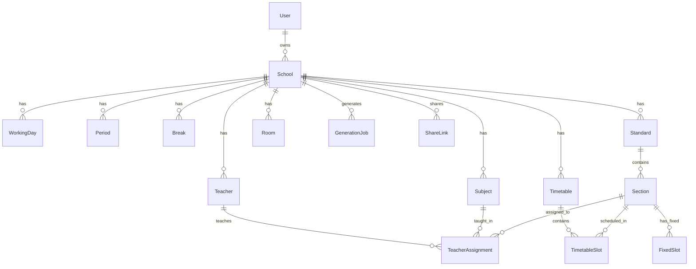

# 🗄️ Database Schema

> Back to [[00 - Project Overview (EdgeEdu)]] · See also [[02 - Backend Deep Dive]]

---

## Entity Relationship Diagram

---

## Models Detail

### `User`
| Column | Type | Notes |
|--------|------|-------|
| `id` | Integer PK | |
| `email` | String (unique, indexed) | Login credential |
| `name` | String | Display name |
| `hashed_password` | String | scrypt hash (`scrypt$salt$key`) |
| `role` | String | Default `"ADMIN"` |
| `created_at` | DateTime | UTC |

---

### `School`
| Column | Type | Notes |
|--------|------|-------|
| `id` | Integer PK | |
| `owner_id` | FK → `users.id` | Nullable (legacy schools have no owner) |
| `name` | String | |
| `board` | Enum(`BoardTemplate`) | CBSE, ICSE, STATE, IB, CUSTOM |
| `periods_per_day` | Integer | Default 8 |
| `half_day_periods` | Integer | Nullable. Fewer periods on half-days |
| `academic_year` | String | e.g. "2025-26" |

**Relationships**: `working_days`, `periods`, `breaks`, `subjects`, `standards`, `rooms`, `teachers`, `timetables`

---

### `WorkingDay`
| Column | Type | Notes |
|--------|------|-------|
| `day_name` | String | Monday, Tuesday, … |
| `is_half_day` | Boolean | Saturday is typically half-day |
| `day_order` | Integer | Sorting order |

---

### `Period`
| Column | Type | Notes |
|--------|------|-------|
| `period_number` | Integer | 1-indexed |
| `start_time` | Time | e.g. 08:00 |
| `end_time` | Time | e.g. 08:45 |
| `label` | String | Optional display label |

---

### `Break`
| Column | Type | Notes |
|--------|------|-------|
| `name` | String | "Lunch", "Short Break" |
| `after_period` | Integer | Inserted after this period number |
| `duration_minutes` | Integer | |

---

### `Subject`
| Column | Type | Notes |
|--------|------|-------|
| `name` | String | "Maths", "Physics" |
| `code` | String | Optional short code |
| `requires_room_type` | Enum(`RoomType`) | CLASSROOM (default), LAB, LIBRARY, HALL, OTHER |
| `color` | String | Hex color for UI (`#6366f1`) |

---

### `Standard`
> A grade/year level like "10th", "Class 5".

| Column | Type | Notes |
|--------|------|-------|
| `name` | String | "10th", "Class 5" |
| `order` | Integer | Sorting order |

**Relationships**: `sections[]`

---

### `Section`
> A class/division like "10th A".

| Column | Type | Notes |
|--------|------|-------|
| `standard_id` | FK → `standards.id` | |
| `name` | String | "A", "B", "C" |
| `strength` | Integer | Default 40 |

---

### `Room`
| Column | Type | Notes |
|--------|------|-------|
| `name` | String | "Lab 1", "Room 201" |
| `room_type` | Enum(`RoomType`) | CLASSROOM, LAB, LIBRARY, HALL, OTHER |
| `capacity` | Integer | Default 40 |
| `is_available` | Boolean | Default True |

---

### `Teacher`
| Column | Type | Notes |
|--------|------|-------|
| `name` | String | |
| `email` | String | Optional |
| `availability` | JSON | `grid[day][period] = true/false`. Null = fully available |
| `max_periods_per_day` | Integer | Default 8 |
| `min_periods_per_week` | Integer | Default 0 (contract minimum) |

---

### `TeacherAssignment`
> One row of the CSV: teacher teaches subject to section N times/week.

| Column | Type | Notes |
|--------|------|-------|
| `teacher_id` | FK | |
| `subject_id` | FK | |
| `section_id` | FK | |
| `lectures_per_week` | Integer | Minimum (or exact) |
| `lectures_per_week_max` | Integer | Nullable. For ranges like "4-5" |
| `preferred_time` | String | "Morning", "Afternoon" — optional soft pref |

---

### `Timetable`
| Column | Type | Notes |
|--------|------|-------|
| `name` | String | |
| `status` | Enum | DRAFT → GENERATING → GENERATED → APPROVED → PUBLISHED / FAILED |
| `generation_log` | String (JSON) | `{status, objective, log}` |
| `published_at` | DateTime | Nullable |

---

### `TimetableSlot`
> One filled cell in the master grid: day × period × section → subject + teacher + room.

| Column | Type | Notes |
|--------|------|-------|
| `section_id` | FK | |
| `teacher_id` | FK | Nullable (free periods) |
| `subject_id` | FK | Nullable |
| `room_id` | FK | Nullable (if no room available) |
| `day_index` | Integer | 0-indexed from first working day |
| `period_index` | Integer | 0-indexed |
| `is_free` | Boolean | |
| `is_fixed` | Boolean | Set by FixedSlot, never overwritten |
| `conflict` | Boolean | Solver couldn't fill this cell |

---

### `FixedSlot`
> Admin-locked slots (assembly, library) the solver never touches.

| Column | Type | Notes |
|--------|------|-------|
| `section_id` | FK | |
| `subject_id` | FK | Optional |
| `label` | String | "Assembly", "Library" |
| `day_index` | Integer | |
| `period_index` | Integer | |

---

### `GenerationJob`
> Background timetable-generation run the UI polls for progress.

| Column | Type | Notes |
|--------|------|-------|
| `timetable_name` | String | |
| `status` | String | QUEUED → RUNNING → SUCCEEDED / FAILED |
| `stage` | String | "preflight", "solving", "saving" — null when done |
| `error` | String (JSON) | List of error strings |
| `timetable_id` | FK | Set on success |
| `finished_at` | DateTime | |

---

### `ShareLink`
> Revocable public token for parent view.

| Column | Type | Notes |
|--------|------|-------|
| `token` | String (unique, indexed) | URL-safe random string |
| `timetable_id` | FK | |
| `revoked` | Boolean | Default False |

---

### `RuleConfig`
> Singleton row (id=1). Global scheduling preferences.

| Column | Type | Default |
|--------|------|---------|
| `keep_key_periods_filled` | Boolean | True |
| `teacher_rest_after_two` | Boolean | True |
| `avoid_back_to_back_free` | Boolean | True |
| `spread_subjects` | Boolean | True |
| `morning_hard_subjects` | Boolean | True |
| `max_doubles_per_week` | Integer | 2 |
| `solve_time_limit` | Integer | 30 (seconds) |
| `ai_provider` | String | "gemini" |
| `ai_api_key` | String | Nullable |

---

### `CustomRule`
| Column | Type | Notes |
|--------|------|-------|
| `rule_type` | String | `subject_time`, `subject_max_per_day`, `subject_position` |
| `subject_name` | String | Matched case-insensitively across all schools |
| `param_text` | String | "morning"/"afternoon" or "first"/"last" |
| `param_int` | Integer | Max per day |
| `enabled` | Boolean | |

---

## Related

- [[02 - Backend Deep Dive]] — model registration
- [[05 - Solver Engine]] — how models feed constraints
- [[10 - CSV Format & Import]] — how data enters the DB
